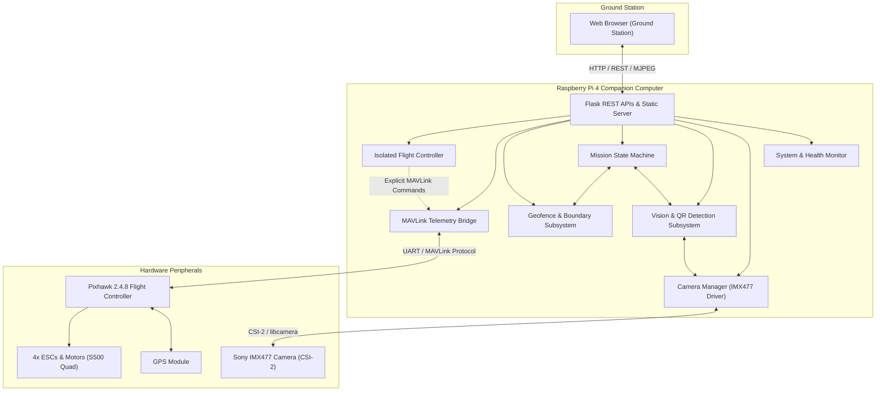

# AUTONOMOUS-DRONE System Architecture

## 1. High-Level System Architecture

The **AUTONOMOUS-DRONE** platform is partitioned into a two-tier control architecture:
1. **Companion Computer (Raspberry Pi 4 Model B):**
   - High-level decision-making, computer vision, QR code decoding, mission lifecycle management, and web ground station communications.
   - Operates Raspberry Pi OS (Linux 64-bit).
2. **Flight Controller (Pixhawk 2.4.8 running ArduPilot/PX4):**
   - Low-level sensor fusion (IMU, Barometer, Compass, GPS), motor ESC control, stabilization, and flight failsafes.
   - Communicates with companion computer via serial UART (TELEM2) using the MAVLink 2 protocol.

---

## 2. Complete Subsystem Architecture

### 2.1 System Monitoring (`backend/system/`)
- **`HardwareInfo` (`hardware_info.py`):**
  - Detects hardware model from `/sys/firmware/devicetree/base/model` and `/proc/cpuinfo`.
  - Determines SoC version (Broadcom BCM2711), hardware revision, board serial number, OS distribution, and core architecture.
  - Automatically identifies non-Pi development hosts (Windows/macOS) and supports safe simulation mode for offline testing.
- **`TemperatureMonitor` (`temperature.py`):**
  - Reads CPU thermal zone `/sys/class/thermal/thermal_zone0/temp` and `vcgencmd measure_temp`.
  - Parses `vcgencmd get_throttled` bitmask to monitor under-voltage brownouts, frequency capping, and thermal throttling.
  - Flags WARNING (> 75°C) and CRITICAL (> 85°C) states.
- **`HealthMonitor` (`health_monitor.py`):**
  - Aggregates overall and per-core CPU utilization, core frequencies, RAM allocation, disk storage, and formatted system uptime.

### 2.2 Camera & Vision Integration (`backend/camera/`)
- **`CameraDetector` (`camera_detector.py`):**
  - Probes CSI-2 ribbon connection for the Sony IMX477 (12.3MP CMOS sensor).
  - Checks `rpicam-hello --list-cameras` and `/dev/video*` devices.
  - Recommends the optimal backend (`libcamera`, `opencv`, or `mock`).
- **`CameraManager` (`camera_manager.py`):**
  - Hardware-independent abstraction layer supporting:
    1. **`libcamera` / `Picamera2`**: Production on Raspberry Pi 4.
    2. **`opencv`**: Standard V4L2 or USB webcam capture.
    3. **`mock`**: Self-contained synthetic drone frame generator with horizon overlay, crosshairs, and live telemetry timestamp.
  - Thread-safe snapshot capture with concurrency lock (`_capture_lock`) saving to `captures/` with timestamped naming: `capture_YYYYMMDD_HHMMSS_ffffff.jpg`.
  - Configurable rotation transformation (`cv2.ROTATE_90_CLOCKWISE`, `180`, `270`).
  - Streaming MJPEG generator for live web dashboard preview.

### 2.3 Computer Vision & QR Detection (`backend/vision/`)
- **`QRDetector` (`qr_detector.py`):**
  - Multi-QR detection and decoding using OpenCV `detectAndDecodeMulti` and fallback `detectAndDecode`.
  - Extracts decoded payload string, corner polygon points, bounding box `(x, y, w, h)`, center point, and confidence metric.
  - Synthetic test QR generator utility for automated testing without external image fixtures.
- **`VisionService` (`vision_service.py`):**
  - Dedicated background worker thread continuously acquiring frames from camera manager at configurable FPS.
  - Configurable duplicate detection cooldown window (`QR_COOLDOWN_SECONDS`) preventing history flooding.
  - Thread-safe ring buffer for detection history.
  - On-demand image file decoding (`process_image_bytes`) for manual uploads.

### 2.4 Pixhawk MAVLink Telemetry (`backend/flight/mavlink_service.py`)
- Read-only MAVLink communication bridge.
- Connects via serial UART (`/dev/ttyAMA0`, `COMx`) or UDP (`udpin:0.0.0.0:14550`).
- Collects: GPS coordinates, fix type, visible satellites, HDOP, altitude (MSL and relative), heading, groundspeed, airspeed, climb rate, attitude (roll, pitch, yaw), battery voltage, and battery percentage.
- Automatic stale telemetry detection when heartbeat age exceeds configurable timeout.
- Realistic simulated drone flight physics generator for desktop testing.

### 2.5 Mission Management (`backend/mission/`)
- Structured `Mission` and `Waypoint` models with coordinate and physical feasibility validation.
- Explicit Finite State Machine:
  `IDLE -> CREATED -> VALIDATED -> READY -> EXECUTING -> PAUSED -> COMPLETED / FAILED / CANCELLED`.
- Thread-safe JSON persistence under `data/missions.json`.
- Secure QR mission association: parses structured tokens (e.g. `MISSION:<id>` or `{"mission_id": "..."}`) and activates pre-validated missions without executing arbitrary code.

### 2.6 Geofence & Navigation Planning (`backend/geofence/`)
- Supports circular (center coordinate + radius in meters) and polygon boundary configurations.
- Planar ray-casting point-in-polygon algorithm and Haversine great-circle distance formulas.
- Minimum floor and maximum ceiling altitude checks.
- Mission waypoint validation: audits all waypoints against active boundaries.
- Navigation planning: computes total trajectory distance in meters and estimated flight duration.

### 2.7 Isolated Flight Controller (`backend/flight/flight_controller.py`)
- Strictly isolated subsystem; disabled by default (`FLIGHT_CONTROL_ENABLED=false`).
- Explicit command interfaces: Arm/Disarm, Mode Change (GUIDED, LOITER, RTL, LAND, STABILIZE), Takeoff, and RTL.
- All requests return HTTP 403 Forbidden while disabled.
- Passes commands through to Pixhawk firmware without bypassing firmware safety checks.
- Audit history logging of all issued flight commands and outcomes.

### 2.8 Ground Station Dashboard (`frontend/`)
- Responsive glassmorphic interface with 7 distinct operational tabs:
  1. Mission Overview
  2. System Health
  3. Camera & Vision
  4. QR Detection
  5. Drone Telemetry
  6. Mission Control
  7. Geofence & Radar Visualizer
- Real-time polling, canvas radar visualizer, and live MJPEG video stream.
