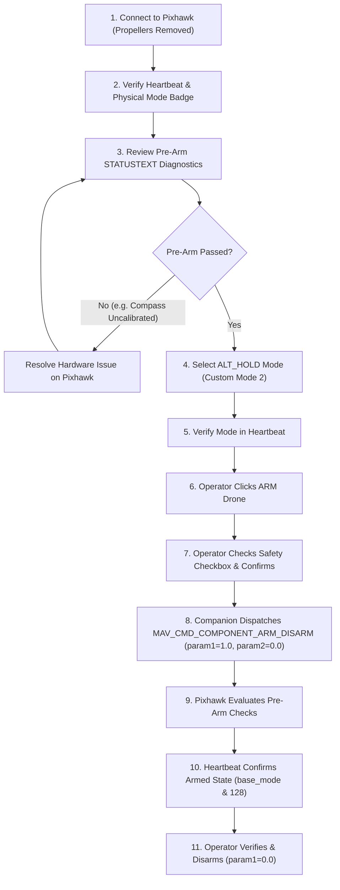

# Pixhawk Flight-Control Subsystem & Safety Guide

## 1. Safety Principles & Architectural Isolation

The flight-control module in **AUTONOMOUS-DRONE** is strictly isolated from sensor monitoring, computer vision, and ground station rendering:
1. **Disabled by Default:** The subsystem requires explicit operational opt-in via `FLIGHT_CONTROL_ENABLED=true` in `.env`. Out of the box, all command endpoints reject requests with HTTP 403 Forbidden.
2. **No Implicit Triggers:** Computer vision detections, QR code parsing, telemetry updates, or page reloads will **never** trigger flight commands or arming.
3. **No Automatic Arming:** The system will never arm the vehicle without an explicit, direct operator request with confirmed safety authorization (`confirm: true`).
4. **Firmware Pre-Arm Authority:** The companion computer does not bypass or override Pixhawk internal failsafes. All pre-arm requirements (gyro calibration, compass health, GPS 3D lock, battery safety, and RC link) are evaluated by the Pixhawk firmware itself.
5. **No Force-Arming:** Force-arming (`FORCE_ARM=true` or param2=21196) is strictly forbidden. Commands always set normal arm parameters (`param1=1.0, param2=0.0`).
6. **No Silent Fallback:** Physical hardware mode never silently degrades to simulation upon connection loss or timeout.

---

## 2. Hardware Architecture & Telemetry Bridge

### Physical Hardware Target
- **Airframe:** S500 quadcopter.
- **Flight Controller:** Pixhawk 2.4.8 running ArduPilot ArduCopter firmware.
- **Companion Computer:** Raspberry Pi 4 Model B running Raspberry Pi OS 64-bit.
- **Communication:** MAVLink 2.0 over Wi-Fi UDP or Serial UART.

### Wi-Fi MAVLink Network Topologies & UDP Direction

Connecting to Pixhawk over Wi-Fi depends on whether the telemetry bridge (e.g. ESP8266/ESP32 running MAVESP8266, or drone onboard router) pushes or listens:

1. **UDP Listening Mode (`udpin:0.0.0.0:14550` - Recommended default):**
   - **Scenario:** The Pixhawk Wi-Fi bridge connects as a Wi-Fi client or broadcasts UDP packets to port 14550.
   - **Configuration:**
     ```ini
     MAVLINK_TRANSPORT=udp
     MAVLINK_CONNECTION=udpin:0.0.0.0:14550
     ```
   - The Raspberry Pi listens on `0.0.0.0:14550`, receives incoming heartbeats, and locks onto the remote sender IP and port.

2. **UDP Outgoing Mode (`udpout:<bridge_ip>:14550`):**
   - **Scenario:** The Pixhawk Wi-Fi bridge creates an Access Point (e.g., `192.168.4.1`) and waits for clients to initiate communication.
   - **Configuration:**
     ```ini
     MAVLINK_TRANSPORT=udp
     MAVLINK_CONNECTION=udpout:192.168.4.1:14550
     ```

3. **Direct Serial UART Connection (`/dev/ttyAMA0`):**
   - Raspberry Pi GPIO 14 (TXD) <-> Pixhawk TELEM2 RX.
   - Raspberry Pi GPIO 15 (RXD) <-> Pixhawk TELEM2 TX.
   - Ground (GND) <-> TELEM2 GND.
   - Baud rate: 57600 baud.

### ArduPilot Parameter Configuration (Mission Planner / QGroundControl)
- `SERIAL2_PROTOCOL = 2` (MAVLink 2)
- `SERIAL2_BAUD = 57` (57600 baud) or `115` (115200 baud)
- `ARMING_CHECK = 1` (All pre-arm checks enabled: compass, accelerometer, barometer, GPS)

---

## 3. Operational Workflow for Flight Commands & AltHold Arming

### Step 1: Bench Safety Pre-Checks (MANDATORY)
> [!CAUTION]
> **PROPELLERS MUST BE COMPLETELY REMOVED** during all initial bench testing and verification.
> Never test arming or flight control activation with propellers attached on a workbench or indoors.

1. Ensure propellers are removed.
2. Confirm 4S LiPo battery is charged (> 15.0V).
3. If safety switch is installed on Pixhawk, press until solid red LED illuminates.

### Step 2: Configure Environment for Physical Hardware
In `.env`:
```ini
FLIGHT_CONTROL_ENABLED=true
MAVLINK_SIMULATE=false
MAVLINK_TRANSPORT=udp
MAVLINK_CONNECTION=udpin:0.0.0.0:14550
FLIGHT_MODE=ALT_HOLD
ARMING_CHECKS_ENABLED=true
FORCE_ARM=false
```

### Step 3: Start Server & Open Ground Station
```bash
python3 backend/app.py
```
Open browser to `http://<PI_IP>:5000` and switch to the **Mission Control** tab.

### Step 4: Staged Physical Hardware Validation Workflow



### Step 5: REST API Command Execution Reference

1. **Verify Flight Status:**
   ```bash
   curl -X GET http://<DRONE_IP>:5000/api/flight/status
   ```
   Inspect `"prearm_status"`, `"prearm_messages"`, and `"connected"`.

2. **Select ALT_HOLD Mode:**
   ```bash
   curl -X POST http://<DRONE_IP>:5000/api/flight/mode \
     -H "Content-Type: application/json" \
     -d '{"mode": "ALT_HOLD"}'
   ```
   ArduCopter assigns custom mode ID `2` for `ALT_HOLD`. The response verifies heartbeat confirmation.

3. **Request Normal Arming:**
   ```bash
   curl -X POST http://<DRONE_IP>:5000/api/flight/arm \
     -H "Content-Type: application/json" \
     -d '{"confirm": true}'
   ```
   - If Pixhawk pre-arm checks pass: returns `200 OK` with `{"armed": true}`.
   - If pre-arm checks fail: returns `400 Bad Request` with exact failure reason extracted from Pixhawk `STATUSTEXT` (e.g. `Pixhawk rejected ARM: PreArm: Compass not healthy`).

4. **Request Disarming:**
   ```bash
   curl -X POST http://<DRONE_IP>:5000/api/flight/disarm
   ```

5. **Disable Flight Control After Operations:**
   In `.env`:
   ```ini
   FLIGHT_CONTROL_ENABLED=false
   ```
   Restart server. All flight endpoints return HTTP 403 Forbidden.

---

## 4. Interpreting ArduPilot Pre-Arm Messages

ArduPilot transmits diagnostic pre-arm warnings via MAVLink `STATUSTEXT` packets. The ground station displays these in the Pre-Arm box:

| STATUSTEXT Message | Root Cause | Resolution |
| :--- | :--- | :--- |
| `PreArm: Compass not calibrated` | Magnetometer offsets unconfigured | Perform onboard compass calibration via Mission Planner |
| `PreArm: Bad GPS Position` / `High HDOP` | Insufficient satellite lock (HDOP > 2.0) | Move vehicle outdoors with clear view of sky |
| `PreArm: Accels inconsistent` | IMU accelerometer calibration required | Perform 6-axis accelerometer calibration |
| `PreArm: Check FS_THR_VALUE` | Throttle failsafe value incorrect | Adjust RC3 minimum and failsafe threshold |
| `PreArm: Safety Switch` | Physical safety switch not depressed | Press physical safety button on GPS mast / Pixhawk |
| `PreArm: Battery below failsafe` | 4S LiPo voltage < 14.0V | Recharge or replace flight battery |

---

## 5. Simulation vs Physical Hardware Verification Distinction

- **Simulation Mode (`MAVLINK_SIMULATE=true`):**
  Used on Windows or offline Linux development. Telemetry is mathematically generated, mock commands immediately toggle internal state flags, and virtual STATUSTEXT messages report passed.
- **Physical Hardware Mode (`MAVLINK_SIMULATE=false`):**
  Uses live UDP or UART connection to Pixhawk 2.4.8. Telemetry reflects actual sensor measurements. Arming and mode changes depend entirely on Pixhawk firmware acknowledgement.
- **Verification Guarantee:** Automated unit and mock tests verify software logic and protocols. Physical flight clearance requires end-to-end bench test with real Pixhawk hardware and propellers removed.

